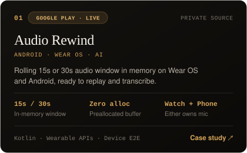
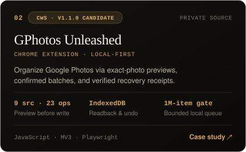
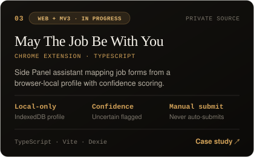
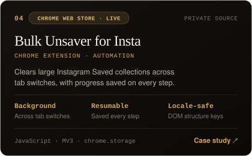

  <a href="https://vrajeshlabs.com"><picture><source media="(prefers-color-scheme: dark)" srcset="./assets/hero-dark.svg" /><source media="(prefers-color-scheme: light)" srcset="./assets/hero-light.svg" /></picture></a>

  <a href="https://vrajeshlabs.com"><picture><source media="(prefers-color-scheme: dark)" srcset="./assets/btn-portfolio-dark.svg" /><source media="(prefers-color-scheme: light)" srcset="./assets/btn-portfolio-light.svg" /></picture></a>&nbsp;<a href="https://www.linkedin.com/in/vrajesh2597"><picture><source media="(prefers-color-scheme: dark)" srcset="./assets/btn-linkedin-dark.svg" /><source media="(prefers-color-scheme: light)" srcset="./assets/btn-linkedin-light.svg" /></picture></a>&nbsp;<a href="mailto:trivedi.vrajesh2597@gmail.com"><picture><source media="(prefers-color-scheme: dark)" srcset="./assets/btn-email-dark.svg" /><source media="(prefers-color-scheme: light)" srcset="./assets/btn-email-light.svg" /></picture></a>&nbsp;<a href="https://www.youtube.com/@trivedi.vrajesh007"><picture><source media="(prefers-color-scheme: dark)" srcset="./assets/btn-youtube-dark.svg" /><source media="(prefers-color-scheme: light)" srcset="./assets/btn-youtube-light.svg" /></picture></a>&nbsp;<a href="https://www.instagram.com/trivedi.vrajesh007/"><picture><source media="(prefers-color-scheme: dark)" srcset="./assets/btn-instagram-dark.svg" /><source media="(prefers-color-scheme: light)" srcset="./assets/btn-instagram-light.svg" /></picture></a>

 

I take products from an initial problem through architecture, implementation, real-device testing, and public release. I care as much about what happens when Bluetooth drops, a Manifest V3 service worker restarts, or a third-party DOM changes as I do about the happy path.

---

### Shipped & Active Products

*Source repositories for these products remain private. Full architecture breakdowns, failure-mode test suites, and real-device recordings are published in each case study on [vrajeshlabs.com](https://vrajeshlabs.com).*

  <a href="https://vrajeshlabs.com/projects/audio-rewind/"><picture><source media="(prefers-color-scheme: dark)" srcset="./assets/card-01-dark.svg" /><source media="(prefers-color-scheme: light)" srcset="./assets/card-01-light.svg" /></picture></a>&nbsp;<a href="https://vrajeshlabs.com/projects/gphotos-unleashed/"><picture><source media="(prefers-color-scheme: dark)" srcset="./assets/card-02-dark.svg" /><source media="(prefers-color-scheme: light)" srcset="./assets/card-02-light.svg" /></picture></a>

  <a href="https://vrajeshlabs.com/projects/may-the-job-be-with-you/"><picture><source media="(prefers-color-scheme: dark)" srcset="./assets/card-03-dark.svg" /><source media="(prefers-color-scheme: light)" srcset="./assets/card-03-light.svg" /></picture></a>&nbsp;<a href="https://vrajeshlabs.com/projects/bulk-unsaver-for-insta/"><picture><source media="(prefers-color-scheme: dark)" srcset="./assets/card-04-dark.svg" /><source media="(prefers-color-scheme: light)" srcset="./assets/card-04-light.svg" /></picture></a>

| Product | Platform | Status | Links |
| :--- | :--- | :--- | :--- |
| **Audio Rewind** | Android & Wear OS | Live | [Case Study](https://vrajeshlabs.com/projects/audio-rewind/) · [Google Play](https://play.google.com/store/apps/details?id=com.audiorewind.watch) |
| **GPhotos Unleashed** | Chrome Extension (MV3) | v1.1.0 Candidate | [Case Study](https://vrajeshlabs.com/projects/gphotos-unleashed/) · CWS submission pending |
| **May The Job Be With You** | Chrome Extension + Web | In Progress | [Case Study](https://vrajeshlabs.com/projects/may-the-job-be-with-you/) · [maythejobbewithyou.in](https://maythejobbewithyou.in) |
| **Bulk Unsaver for Insta** | Chrome Extension (MV3) | Live | [Case Study](https://vrajeshlabs.com/projects/bulk-unsaver-for-insta/) · [Chrome Web Store](https://chromewebstore.google.com/detail/bulk-unsaver-for-insta/jkkbfimmfiegakhkknnlolfgkhljggai) |

---

### Capabilities & Process

  <picture><source media="(prefers-color-scheme: dark)" srcset="./assets/stack-dark.svg" /><source media="(prefers-color-scheme: light)" srcset="./assets/stack-light.svg" /></picture>

---

### About the Public Repositories

Public repositories below contain earlier Android, QGIS/OpenLayers, Python, and data-analysis projects. Active store-published and commercial products remain in private repositories and are documented in full on [vrajeshlabs.com](https://vrajeshlabs.com).

 

  <a href="https://vrajeshlabs.com"><picture><source media="(prefers-color-scheme: dark)" srcset="./assets/footer-dark.svg" /><source media="(prefers-color-scheme: light)" srcset="./assets/footer-light.svg" /></picture></a>

